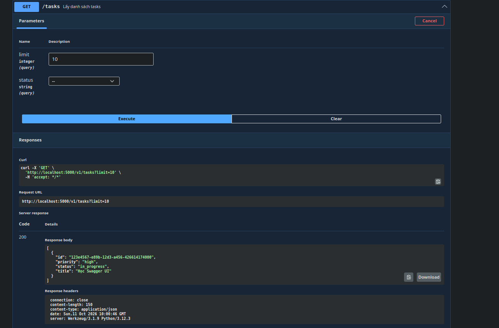

## 1. Kết quả bài 4 "Try it out" với api GET http://localhost:5000/v1/tasks?limit=10

## 2. Hai quyết định thiết kế khó nhất (Design Decisions)

###  Quyết định 1: Áp dụng phương pháp Design-First & Giữ file `openapi.yaml` độc lập làm Single Source of Truth
* **Thách thức:** Khi xây dựng REST API bằng Flask, có hai cách tiếp cận chính:
  1. *Code-First (Dùng `apispec` / docstring):* Viết code Python trước rồi nhúng YAML docstring trong hàm để thư viện tự sinh spec.
  2. *Design-First (Viết `openapi.yaml` độc lập):* Thiết kế file OpenAPI trước rồi cấu hình Flask đọc và serve tĩnh file spec này.
* **Lựa chọn thiết kế:** Nhóm quyết định chọn phương pháp **Design-First** với file `openapi.yaml` nằm độc lập hoàn toàn với mã nguồn Flask.
* **Lý do & Đánh đổi:**
  * **Ưu điểm:** Đảm bảo tính trung lập, không bị phụ thuộc vào ngôn ngữ lập trình hay framework (Flask). File `openapi.yaml` trở thành bản hợp đồng (API Contract) chuẩn mực để cả Frontend, Backend và QA cùng làm việc song song mà không cần đợi code chạy hoàn chỉnh.
  * **Đánh đổi:** Phải tự duy trì tính đồng bộ giữa đặc tả (`openapi.yaml`) và implementation thực tế trong `app.py` bằng tay (hoặc qua contract test), không tự động sinh ra từ code.

---

###  Quyết định 2: Chuẩn hóa cấu trúc Response lỗi dùng chung và tái sử dụng qua `$ref`
* **Thách thức:** Hệ thống có nhiều HTTP Status Code cho các kịch bản lỗi khác nhau (`401 Unauthorized`, `404 Not Found`, `422 Unprocessable Entity`). Nếu định nghĩa chi tiết cấu trúc Schema lỗi ở từng operation trong `paths`, file YAML sẽ bị trùng lặp dữ liệu khổng lồ (code duplication) và khó bảo trì khi đổi định dạng báo lỗi.
* **Lựa chọn thiết kế:** Tách biệt toàn bộ cấu trúc báo lỗi ra mục `components`:
  * Định nghĩa một Schema lỗi chuẩn trong `components.schemas.Error` (gồm các trường `status`, `message`).
  * Định nghĩa các mẫu response lỗi chuẩn trong `components.responses` (`NotFound`, `Unauthorized`, `ValidationError`).
  * Tại các endpoint cụ thể dưới `paths`, chỉ sử dụng `$ref` trỏ tới các response mẫu này (ví dụ: `$ref: '#/components/responses/NotFound'`).
* **Lý do & Đánh đổi:**
  * **Ưu điểm:** Tuân thủ nguyên tắc DRY (Don't Repeat Yourself), đảm bảo toàn bộ API trả về format lỗi nhất quán, giúp client (Frontend/Mobile) viết xử lý lỗi tập trung dễ dàng hơn.
  * **Đánh đổi:** Tăng số lượng tham chiếu lồng nhau trong file YAML, đòi hỏi người đọc spec phải hiểu cơ chế phân tầng `$ref` trong OpenAPI Specification.