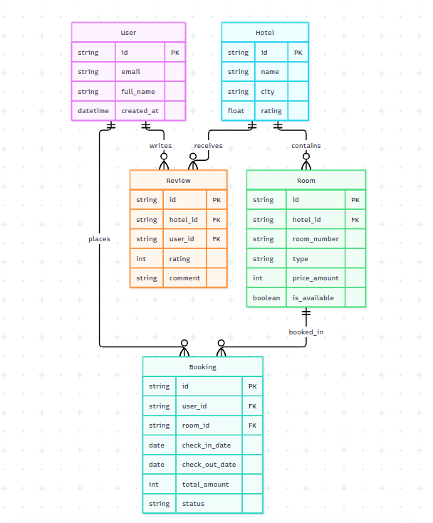

# Hotel Booking API - Resource Design (Bài 1)

Tài liệu này mô tả thiết kế kiến trúc API cho hệ thống **Đặt phòng Khách sạn (Hotel Booking)**, bao gồm Mô hình thực thể (ERD), Danh sách Endpoint (URL List) và các sơ đồ xác thực dữ liệu (JSON Schema).

---

## 1. Mô hình ERD & Các thực thể cốt lõi

Hệ thống bao gồm 5 thực thể chính:
* **User (Người dùng)**: Quản lý thông tin khách hàng và tài khoản hệ thống.
* **Hotel (Khách sạn)**: Thông tin chi tiết về các khách sạn đối tác.
* **Room (Phòng)**: Thuộc về một khách sạn cụ thể (Quan hệ `1:N` với Hotel).
* **Booking (Đơn đặt phòng)**: Ghi nhận giao dịch đặt phòng giữa User và Room (Quan hệ `N:1` với User và Room).
* **Review (Đánh giá)**: Khách hàng đánh giá chất lượng khách sạn (Quan hệ `1:N` với Hotel và User).

---

## 2. URL List (15 Endpoints)

Tuân thủ các nguyên tắc thiết kế RESTful API (danh từ số nhiều, `kebab-case`, không dùng động từ trong URL, sử dụng đúng HTTP methods và phân cấp resource hợp lý):

### Quản lý Khách sạn (Hotels)
* `GET /api/v1/hotels` - Lấy danh sách khách sạn (hỗ trợ phân trang, lọc theo thành phố/rating).
* `POST /api/v1/hotels` - Tạo mới một khách sạn (dành cho admin/đối tác).
* `GET /api/v1/hotels/{hotel_id}` - Xem chi tiết thông tin của một khách sạn cụ thể.
* `PUT /api/v1/hotels/{hotel_id}` - Cập nhật toàn bộ thông tin khách sạn.
* `DELETE /api/v1/hotels/{hotel_id}` - Xóa khách sạn khỏi hệ thống.

### Quản lý Phòng (Rooms - Quan hệ 1-N với Hotel)
* `GET /api/v1/hotels/{hotel_id}/rooms` - Lấy danh sách tất cả các phòng thuộc một khách sạn cụ thể.
* `POST /api/v1/hotels/{hotel_id}/rooms` - Thêm mới một phòng vào khách sạn chỉ định.
* `GET /api/v1/rooms/{room_id}` - Xem chi tiết thông tin của một phòng (Top-level view).
* `PUT /api/v1/rooms/{room_id}` - Cập nhật thông tin phòng.
* `DELETE /api/v1/rooms/{room_id}` - Xóa phòng khỏi hệ thống.

### Quản lý Đặt phòng (Bookings)
* `GET /api/v1/bookings` - Lấy danh sách các đơn đặt phòng (hỗ trợ lọc theo user hoặc trạng thái).
* `POST /api/v1/bookings` - Tạo một đơn đặt phòng mới.
* `GET /api/v1/bookings/{booking_id}` - Xem chi tiết một đơn đặt phòng.
* `PATCH /api/v1/bookings/{booking_id}/cancel` - Cập nhật trạng thái hủy đơn đặt phòng.

### Quản lý Đánh giá (Reviews - Quan hệ 1-N với Hotel)
* `GET /api/v1/hotels/{hotel_id}/reviews` - Lấy danh sách các đánh giá của một khách sạn.
* `POST /api/v1/hotels/{hotel_id}/reviews` - Gửi một đánh giá mới cho khách sạn.

### ERD

