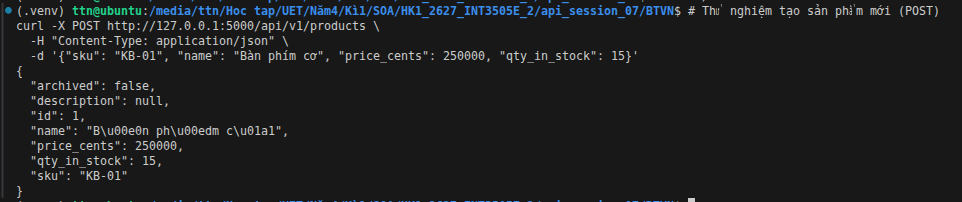
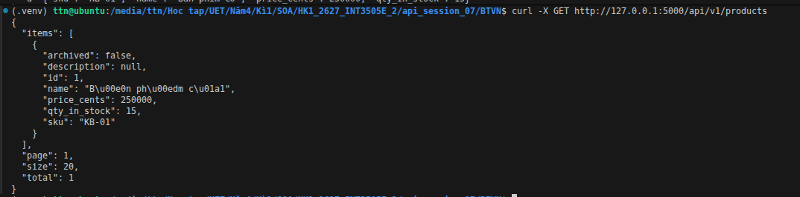
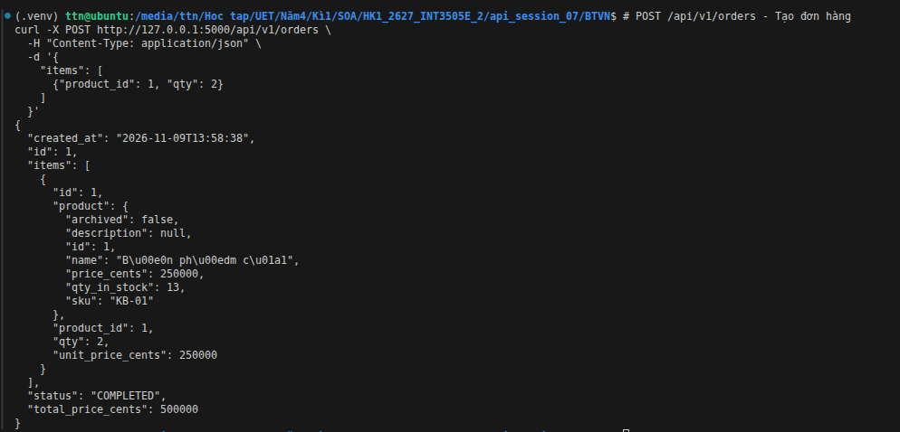
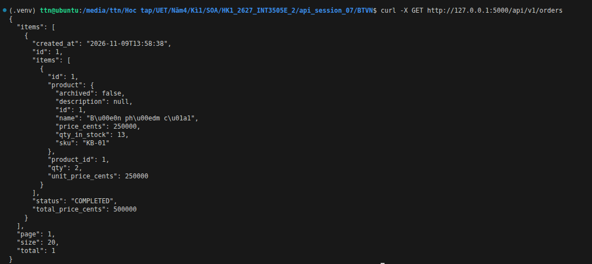
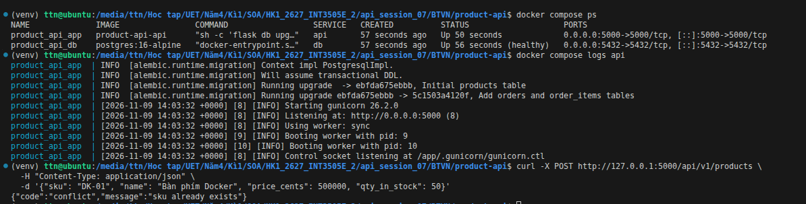
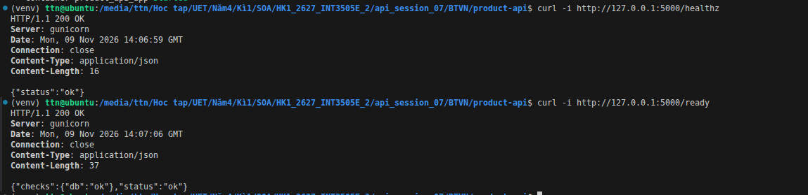
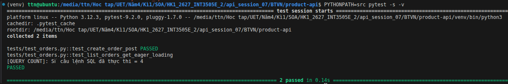

Bài 1:

Bài 2:

- api tạo đơn hàng

- api lấy danh sách đơn hàng

Bài 3:

Kiểm tra trạng thái 2 container
Xem log migration 

Test api tạo sản phầm mới tong PostgreSQL Docker

Bài 4: 

Kiểm tra 2 endpoint /healthz và /ready

Bài 5:

Chạy Pytest

