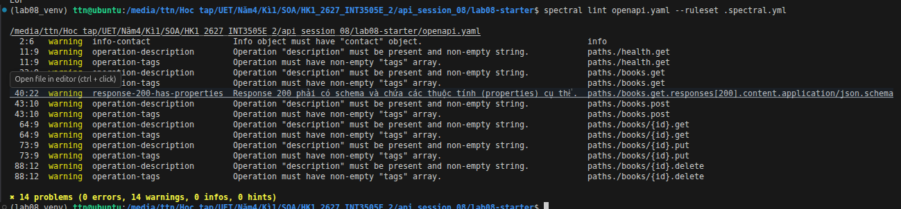
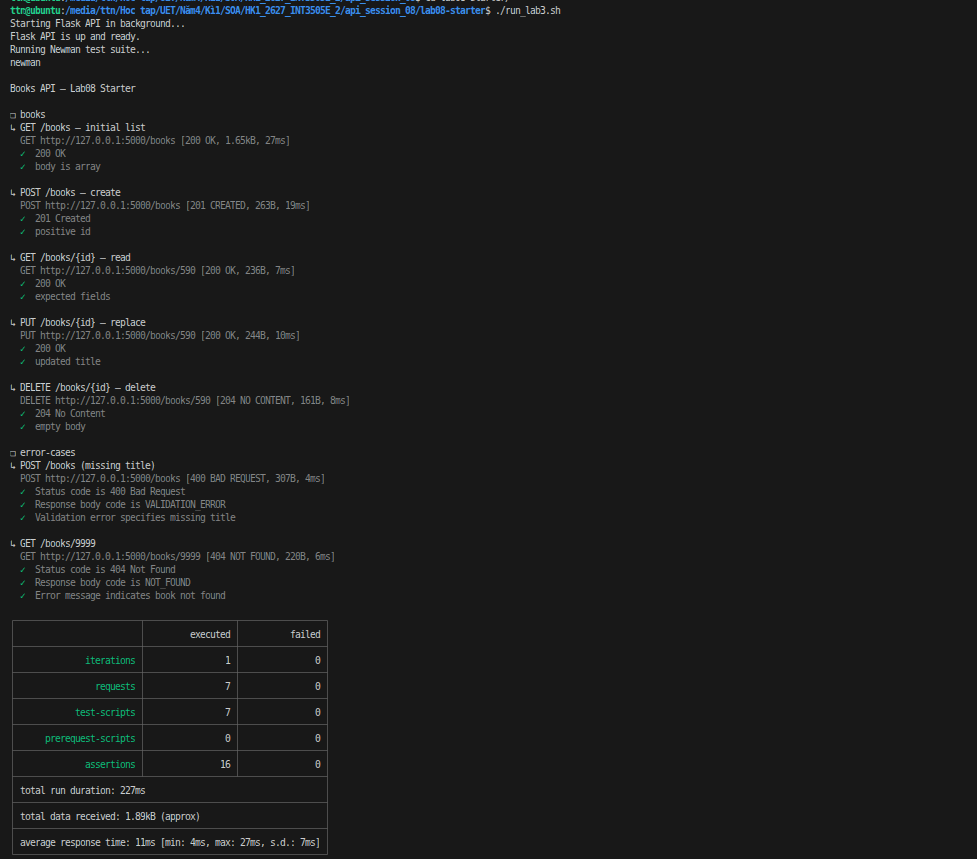
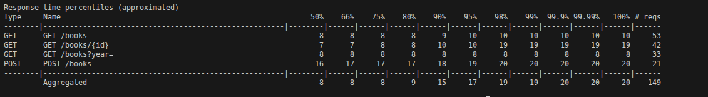
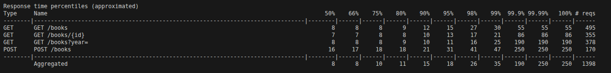
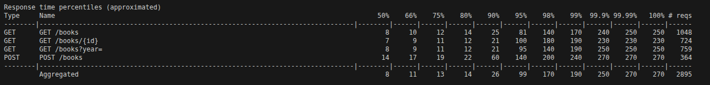

Lab1

Kết quả khi chạy 4 test trong bước 1


Bước 2


Lab2




Lab3

- Thêm folder `error-cases/` gồm:
  - `POST /books`: thiếu title -> trả về 400 + `VALIDATION_ERROR`
  - `GET /books/9999`: id không tồn tại -> trả về 404 + `NOT_FOUND`
- Lưu `book_id` bằng `collectionVariable` ở POST để dùng lại cho DELETE.
- Chạy Newman và xuất file `junit.xml`:

```bash
newman run books-api.postman_collection.json -e staging.postman_environment.json -r cli,junit --reporter-junit-export junit.xml
```

Kết quả:




Lab4

- Viết thêm task `search_by_year(year)` trong `performance/locustfile.py` có giả lập 1% fail rate.
- Chạy 3 kịch bản load test:
  - **Kịch bản A (baseline)**: 10 users, spawn rate 2/s, thời gian 30s -> `reports/A.html`
  - **Kịch bản B (load test)**: 50 users, spawn rate 5/s, thời gian 60s -> `reports/B.html`
  - **Kịch bản C (spike test)**: 200 users, spawn rate 50/s, thời gian 30s -> `reports/C.html`

Bảng kết quả đo:

- Kịch bản A:



- Kịch bản B:



- Kịch bản C:



Chi tiết phân tích các câu hỏi xem trong file [performance/analysis.md](lab08-starter/performance/analysis.md).
