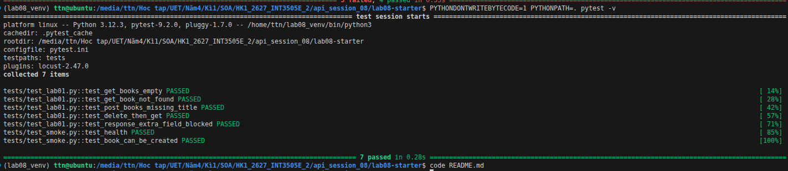
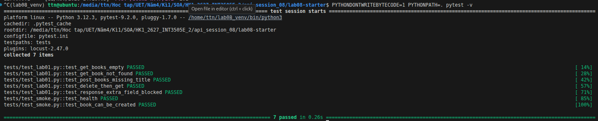

Lab1

Kết quả khi chạy 4 test trong bước 1



Bước 2




Lab2


Lab3

- Thêm folder `error-cases/` gồm:
  - `POST /books`: thiếu title -> trả về 400 + `VALIDATION_ERROR`
  - `GET /books/9999`: id không tồn tại -> trả về 404 + `NOT_FOUND`
- Lưu `book_id` bằng `collectionVariable` ở POST để dùng lại cho DELETE.
- Chạy Newman và xuất file `junit.xml`:

```bash
newman run books-api.postman_collection.json -e staging.postman_environment.json -r cli,junit --reporter-junit-export junit.xml
```

Kết quả:


